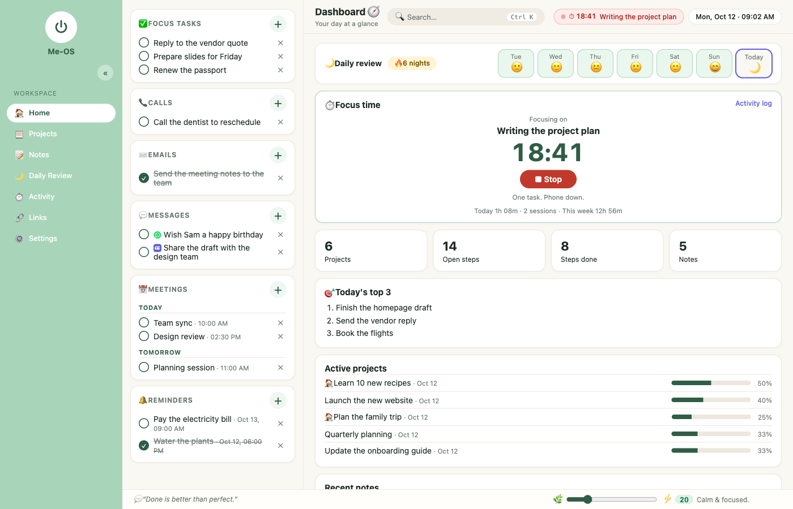
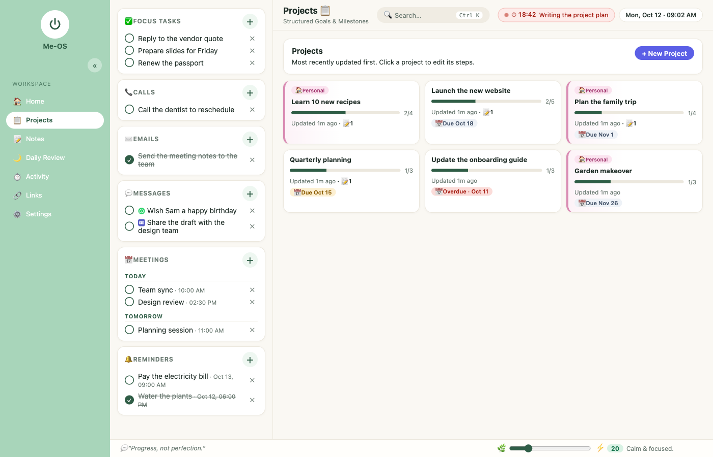
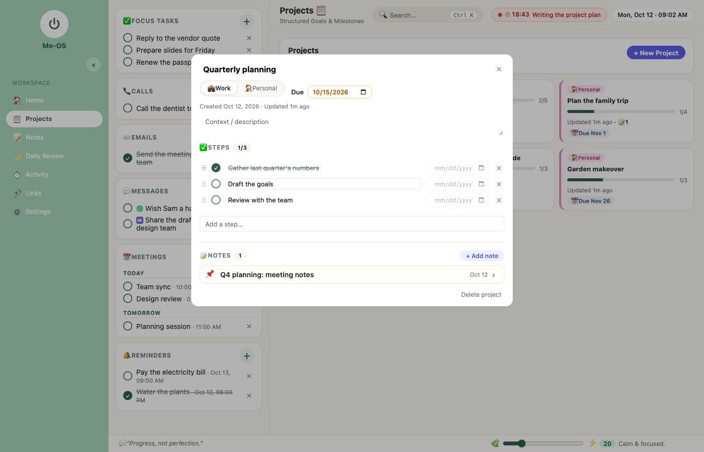
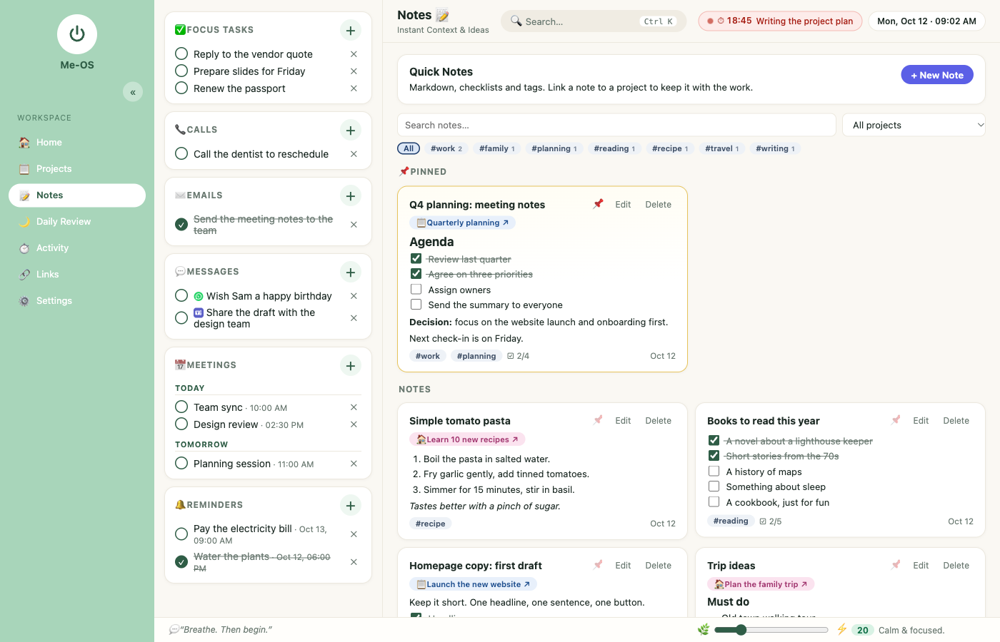
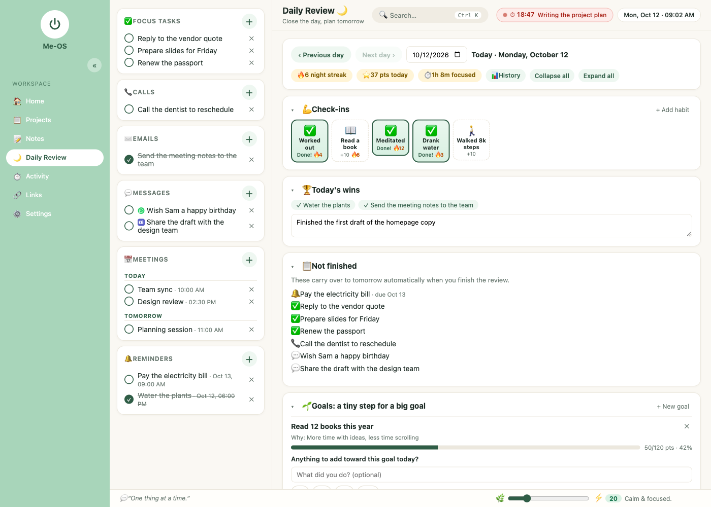
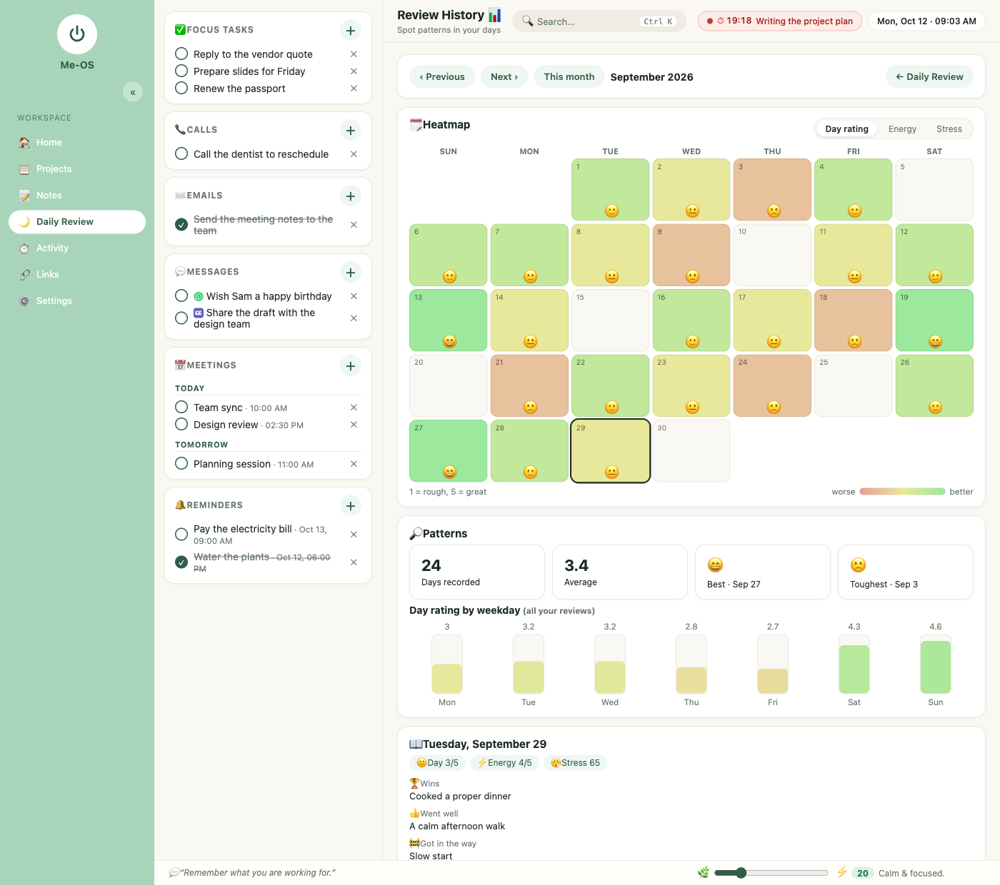
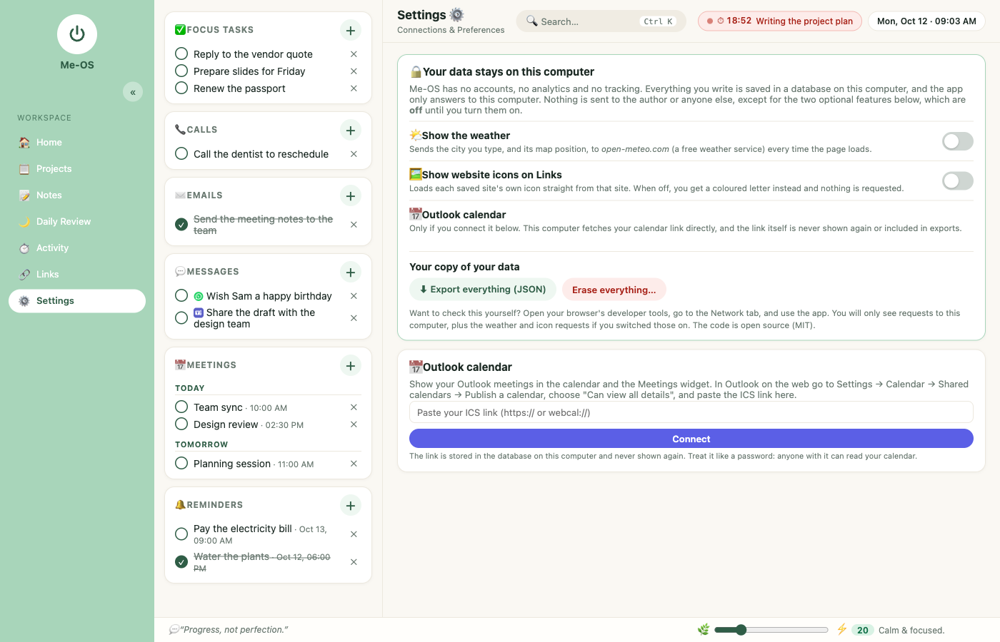
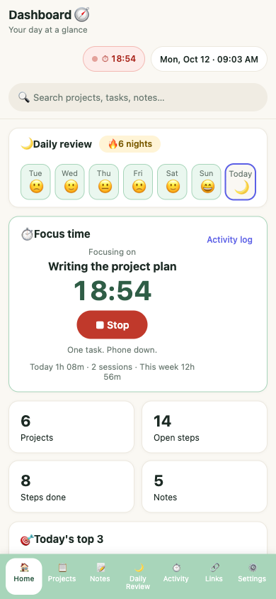

# Me-OS

**A simple operating system for a person.** One calm place for your day: what to do, what you're working on, what you
noticed, and how it went. It runs on your own computer, and your data stays there.




## What it does

- **Dashboard**: your day at a glance, with a 7-night review strip, a focus timer and today's top priorities.
- **Tasks column**: Focus tasks, calls, emails, messages (WhatsApp or Teams), meetings and reminders, always beside you.
- **Projects**: compact cards with steps you can drag into order, due dates, a Work or Personal type, and notes.
- **Notes**: markdown with tickable checklists, `#tags`, pinning, search, and links to projects.
- **Daily Review**: a short nightly ritual: check-ins with streaks, wins, goals moved forward in tiny steps, reflection,
  tomorrow's top 3, and a brain dump. Plus a **History** page with a heatmap of rating, energy and stress.
- **Focus timer and Activity log**: start a timer on one thing and stop when you're done. Keeps a paged log.
- **Calendar**: a month view with your due items, project deadlines and (optionally) your Outlook meetings.
- **Links**: quick-launch links to the sites you use every day.
- **Works offline** as an installable app (PWA), and on phones.

## Screenshots

*All screenshots use invented demo data.*

| | |
|---|---|
| [](docs/screenshots/projects.png)<br>**Projects**: compact cards with progress, due dates and a pink badge for personal projects. | [](docs/screenshots/project-editor.png)<br>**Project editor**: reorderable steps with due dates, plus the notes that belong to the project. |
| [](docs/screenshots/notes.png)<br>**Notes**: markdown with tickable checklists, tags, pinning and links back to projects. | [](docs/screenshots/daily-review.png)<br>**Daily Review**: check-ins with streaks, wins, what's unfinished, and goals moved forward in tiny steps. |
| [](docs/screenshots/history.png)<br>**Review History**: a month heatmap of rating, energy or stress, with weekday patterns. | [](docs/screenshots/privacy.png)<br>**Privacy**: optional internet features are off until you switch them on, and you can export or erase everything. |

<p align="center">
  <br>
  <em>It works on a phone too, as an installable app.</em>
</p>

## Your data stays with you

- No accounts, no analytics, no tracking. Nothing is sent to the author.
- Everything is saved in a PostgreSQL database **on your computer**.
- The app only answers on `localhost`. It refuses requests from other machines and from other websites.
- Two optional features talk to the internet, and both are **off until you switch them on** in *Settings → Privacy*:
  - **Weather** sends the city you type, and its map position, to [open-meteo.com](https://open-meteo.com).
  - **Website icons** load each saved link's own `favicon.ico`, straight from that site.
- If you connect an Outlook calendar (optional), your computer fetches the calendar link you give it directly.
  The link is never shown again and is never included in an export.
- *Settings → Privacy* lets you **export everything as JSON** and **erase everything** in one step.

You don't have to take this on trust: the code is open (MIT), and you can watch the browser's Network tab while you use it.

## Quick start with Docker

You need [Docker](https://www.docker.com/products/docker-desktop/). Then:

```sh
git clone <this repository>
cd <this repository>
docker compose up -d
```

Open **http://localhost:4000**. That's it. Your data lives in a Docker volume on your computer.

- Stop it: `docker compose down` (your data is kept). Delete it with `docker compose down -v`.
- Optional: copy `.env.example` to `.env` and set your own `POSTGRES_PASSWORD` before the first start.
- Back up: `docker compose exec db pg_dump -U meos meos > me-os-backup.sql`, or use *Settings → Export everything*.

## Quick start without Docker

You need Node 20 or newer and PostgreSQL 14 or newer.

```sh
createdb meos                      # or any database name you like
cp server/.env.example server/.env # then edit DATABASE_URL to match your database
npm run install:all
npm run build
npm start                          # migrates the database, then serves the app
```

Open **http://localhost:4000**.

## Development

```sh
npm run install:all
npm run db:up        # a development Postgres in Docker (or point server/.env at your own)
npm run migrate
npm run dev:server   # API on http://127.0.0.1:4000
npm run dev:client   # app on http://localhost:5173, proxying /api to the API
```

The client is React + TypeScript (Vite). The server is Node + Express + TypeScript on PostgreSQL.
See [docs/API.md](docs/API.md) for the endpoints.

## Security model

Me-OS is for **one person on their own computer**. It deliberately has no login. Please don't put it on the public
internet or a shared server. See [SECURITY.md](SECURITY.md).

## Known limits

- One user, one computer. There is no sync between devices.
- No import yet (there is an export).
- The Docker setup is new. If something doesn't work, please open an issue.

## Licence

[MIT](LICENSE). Contributions are welcome: see [CONTRIBUTING.md](CONTRIBUTING.md).
